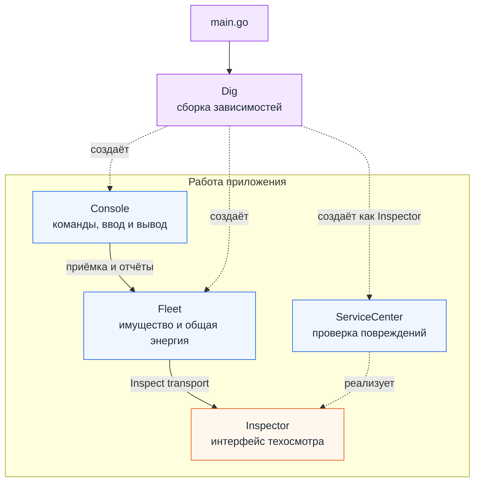
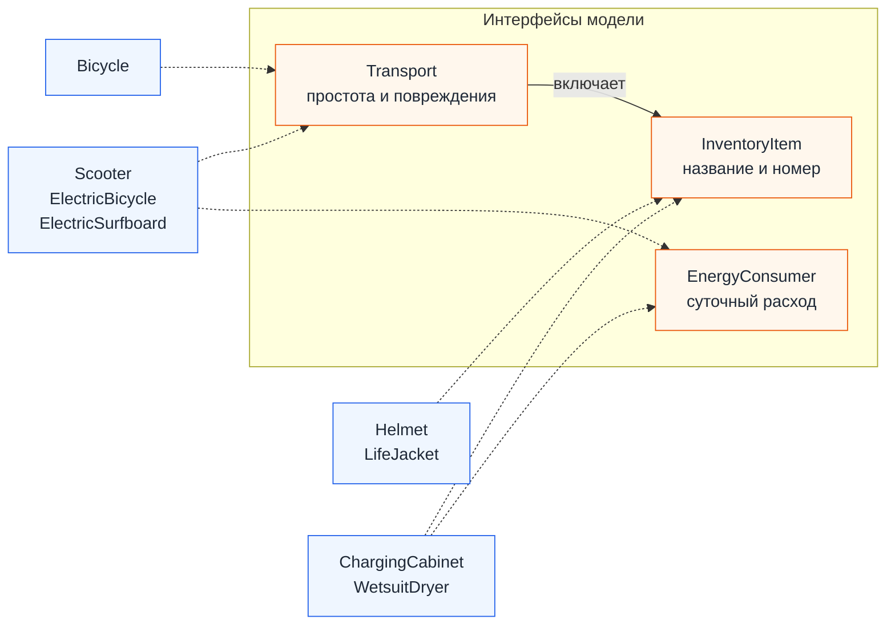

# kpo-vyshkat

«ВышКат» - учет транспорта и вещей кикшеринга: прием техники после техосмотра, просмотр энергопотребления и выбор устройства для новичков. Проект выполнен на Go в рамках ДЗ-1 по КПО с применением SOLID и DI-контейнера Uber Dig.

## Запуск

Нужен Go 1.27.2 или новее. Выполняйте команды из корня репозитория `kpo-vyshkat`, где находится `go.mod`:

```powershell
go mod download
go run .
```

Основные сценарии можно посмотреть без ручного ввода: `go run . -demo`.

Данные хранятся в памяти и не сохраняются между запусками.

## Использование

| Команда | Действие |
| --- | --- |
| `add transport` | Запрашивает вид транспорта, название, номер, простоту и наличие повреждений; для электротранспорта также расход энергии. Добавляет объект в парк после одобрения техосмотра |
| `add item` | Запрашивает вид вещи, название и номер; для потребителя энергии также суточный расход. Добавляет вещь на баланс без техосмотра |
| `report` | Показывает количество транспорта и вещей, общее число объектов и суммарный суточный расход энергии в кВт·ч |
| `beginners` | Выводит принятый транспорт с простотой не ниже 6: название, номер и оценку простоты. Список упорядочен по убыванию простоты |
| `inventory` | Выводит всё имущество с названиями, инвентарными номерами и отметкой «транспорт» или «вещь». Список упорядочен по номеру |
| `help` | Показывает список команд с краткими пояснениями |
| `exit` | Завершает приложение; данные текущего запуска не сохраняются |

После команды программа последовательно спросит характеристики объекта. Команды можно писать в любом регистре, расход вводить с точкой или запятой, а на вопрос о повреждениях отвечать `да/нет`. При ошибке появится объяснение, после чего можно продолжить работу.

Транспорт: `bicycle` (велосипед), `scooter` (электросамокат), `ebike` (электровелосипед), `surf` (электросёрф).
Вещи: `helmet` (шлем), `charger` (зарядный шкаф), `vest` (спасательный жилет), `dryer` (сушилка гидрокостюмов).

## Правила и модель

- Название и номер непустые, пробелы по краям удаляются. Номер уникален среди принятого транспорта и вещей, регистр номера сохраняется.
- `ServiceCenter` принимает транспорт без критических повреждений. Вещи учитываются без техосмотра.
- Простота транспорта задаётся от 1 до 10. В список новичков попадает принятый транспорт с простотой ≥ 6, по убыванию простоты.
- Суточная энергия является заданной характеристикой. Суммируются расходы транспорта и вещей, потребляющих электричество. Допустим ноль, отрицательные и неконечные значения отклоняются.
- Общая энергия хранится в парке. Она меняется только после успешного добавления; любой отказ оставляет состояние прежним. Характеристики принятого объекта должны оставаться постоянными.
- Выдача клиентам, история поездок, поиск отдельной командой и удаление в эту версию не входят.

### Интерфейсы

Интерфейсы определяют, что парк получает от объекта, а структуры хранят данные. В Go структура подходит под интерфейс, если реализует нужные методы.

| Интерфейс | Что предоставляет | Где используется |
| --- | --- | --- |
| `InventoryItem` | `Name()`, `InventoryNumber()` | Учёт и вывод всего имущества |
| `EnergyConsumer` | `DailyEnergy()` | Суммирование суточного расхода |
| `Transport` | Включает `InventoryItem`, добавляет `Ease()` и `HasCriticalDamage()` | Приёмка и отбор для новичков |
| `Inspector` | `Inspect(Transport) bool` | Решение о приёмке; реализацию можно подменить |

Первые три интерфейса находятся в [model.go](internal/model/model.go), `Inspector` объявлен в [fleet.go](internal/fleet/fleet.go).

В Go нет наследования классов, поэтому общая модель построена на интерфейсах и композиции. Транспорт встраивает `transportData`, вещи используют `inventoryData`, а потребители энергии получают ещё и `energyData`. Поля моделей скрыты, методов изменения характеристик нет.

### Конкретные структуры

Объекты создаются через `NewBicycle`, `NewScooter` и другие конструкторы. Они проверяют характеристики и возвращают значение структуры либо объясняют ошибку в данных.

| Структуры | Общие составные части | Выполняемые интерфейсы |
| --- | --- | --- |
| `Bicycle` | `transportData` | `Transport`, следовательно и `InventoryItem` |
| `Scooter`, `ElectricBicycle`, `ElectricSurfboard` | `transportData` и `energyData` | `Transport`, `InventoryItem`, `EnergyConsumer` |
| `Helmet`, `LifeJacket` | `inventoryData` | `InventoryItem` |
| `ChargingCabinet`, `WetsuitDryer` | `inventoryData` и `energyData` | `InventoryItem`, `EnergyConsumer` |

`inventoryData` объединяет название и номер, а `transportData` добавляет к ним простоту и повреждения. Суточный расход хранится в `energyData`. Встраивание позволяет переиспользовать общие поля и методы.

## Архитектура и DI

| Модуль | Ответственность |
| --- | --- |
| [model](internal/model/model.go) | Типы объектов, характеристики и проверка данных |
| [fleet](internal/fleet/fleet.go) | `Fleet` хранит имущество и строит отчёты; `ServiceCenter` реализует `Inspector` и проверяет повреждения |
| [cli](internal/cli/console.go) | `Console` читает команды, вызывает парк и выводит результат |
| [main.go](main.go) | Параметры запуска и сборка приложения |

Всё имущество добавляется через `Fleet.Add`, поэтому правила приёмки собраны в одном месте. Парк хранит объекты в `map` по номеру, а решение техосмотра получает через `Inspector`. Любой транспорт проходит проверку, даже если передан как `InventoryItem`.

При запуске `buildContainer` объясняет Dig, как получить инспектор, парк, консоль и потоки ввода/вывода. Контейнер создаёт объекты и передаёт зависимости в конструкторы. После сборки бизнес-логика работает с полученными объектами самостоятельно. В юнит-тестах двойник передаётся прямо в `NewFleet`, а подмена через Dig проверяется отдельно.

Dig берёт на себя связывание зависимостей и при сборке приложения сообщает, если нужная зависимость отсутствует или связи образуют цикл.

### Схема связей

При запуске Dig собирает приложение. Затем консоль обращается к парку, а парк получает решение техосмотра через интерфейс `Inspector`.



Связи модели показаны отдельно. В одном блоке объединены конкретные структуры с одинаковым набором интерфейсов. Пунктир означает реализацию интерфейса, а `Transport` включает методы `InventoryItem`.



## SOLID

| Принцип | Применение |
| --- | --- |
| SRP | Модель проверяет данные, техосмотр решает вопрос пригодности, парк ведёт учёт, консоль общается с пользователем |
| OCP | Новый тип с нужными методами участвует в общих отчётах без изменения `Fleet`; выбор вида в CLI нужно дополнить |
| LSP | Реализации соблюдают договор интерфейсов: корректные номера, простота 1–10, постоянный допустимый расход |
| ISP | Энергопотребление отделено от инвентаризации; шлему не нужен метод расхода энергии |
| DIP | Парк зависит от `Inspector`, а конкретный `ServiceCenter` передаётся снаружи |

Наиболее явно проявляется DIP: парк знает только интерфейс техосмотра. В тестах ему передаётся другая реализация, чтобы проверить, как он следует её решению.

Для ISP сделан осознанный компромисс: `Transport` объединяет простоту и повреждения, хотя техосмотру нужны только повреждения. В небольшом приложении эти характеристики оставлены вместе, чтобы не дробить модель дополнительными интерфейсами.

## Расширение

- Новый транспорт реализует `Transport` и при необходимости `EnergyConsumer`. Добавляются конструктор и выбор в CLI; общий учёт не меняется. Это проверяет `TestNewTransportWorksWithoutFleetChanges`.
- Другое правило техосмотра реализуется в `ServiceCenter` либо другой реализацией `Inspector`. Если правилу нужны новые характеристики, потребуется расширить модель. Выбор разных проверок по видам транспорта сейчас не реализован.
- Сотрудникам нужна отдельная модель и операции, они не включаются в баланс имущества.
- Отдельная пронумерованная запчасть может быть `InventoryItem`. Количественные остатки и складские операции потребуют отдельного учёта.
- При добавлении удаления или изменения расхода нужно согласованно обновлять сохранённую сумму энергии.

## Тестирование

```powershell
go test ./... '-coverprofile=coverage.out'
go tool cover '-func=coverage.out'
go vet ./...
go mod verify
go build -o bin/vyshkat.exe .
```

В [fleet_test.go](internal/fleet/fleet_test.go) проверяются приёмка, отказы, повторные номера, энергия, инвентаризация и граница простоты 5/6. `TestServiceCenterDecision` фиксирует правило техосмотра, `TestAdmissionUsesInjectedInspector` передаёт stub через конструктор, `TestBeginnerBoundaryAndOrder` проверяет отбор новичков.

[model_test.go](internal/model/model_test.go) проверяет конструкторы и границы данных. [console_test.go](internal/cli/console_test.go) проверяет команды, ошибки, незавершённый ввод и демонстрацию. В [main_test.go](main_test.go) проверяются параметры запуска и сборка через настоящий Dig с подменой инспектора.

Модель и парк проверяются модульными тестами. Сценарии консоли и конфигурации Dig проверяют совместную работу модулей. Сами тесты не обращаются к сети и файлам и не зависят от текущего времени или случайных данных.

Общее покрытие составляет 93,2%. Сборка, тесты, `go vet`, проверка модулей и демонстрация выполнены.

После демонстрации в парке окажутся 4 транспорта и 4 вещи с общим расходом 7,00 кВт·ч в сутки. Новичкам подходят три устройства. Электросёрф с простотой 5 проходит техосмотр, но не попадает в этот список; отклонённые объекты итог не меняют.

## Использование ИИ
